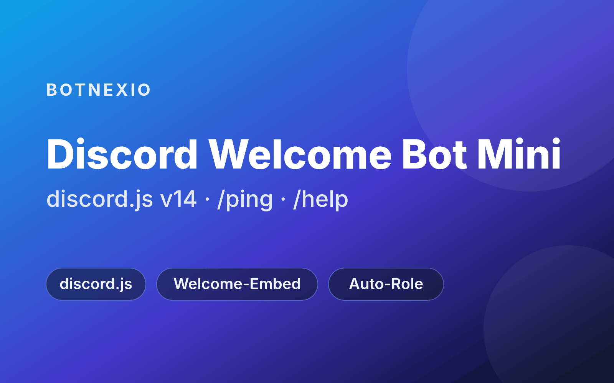

# Discord Welcome Bot Mini

A small single-file discord.js v14 bot that welcomes new members with an embed, can give them a role automatically, and answers `/ping` and `/help`.

## Features
- Welcome embed in a channel of your choice when someone joins the server
- Configurable title, message and color, with placeholders `{user}` (mention), `{username}`, `{server}`, `{memberCount}`
- Optional auto-role for new members (bots are skipped)
- Slash commands `/ping` and `/help` (registered instantly on one server via `GUILD_ID`, otherwise globally)
- Clear one-line error messages for a missing or invalid token, missing intents and bad IDs
- One file (`src/bot.js`), two dependencies (discord.js, dotenv), no dashboard, no database

## Setup in 5 minutes
1. **Install Node.js 22.13 or newer** (`package.json` requires `"node": ">=22.13"`). Check with `node -v`.
2. **Create a Discord application and bot:** open the [Discord Developer Portal](https://discord.com/developers/applications) → *New Application* → *Bot*. Click *Reset Token* and copy the token. Never share or commit it.
3. **Enable the intent:** in *Bot* → *Privileged Gateway Intents*, turn on **Server Members Intent** (`GUILD_MEMBERS`). Without it Discord does not send join events. The bot also uses the non-privileged `GUILDS` intent.
4. **Invite the bot** with the scopes `bot` and `applications.commands` and the permissions View Channels, Send Messages, Embed Links, plus Manage Roles if you use the auto-role (permissions integer `268454912`). Replace `CLIENT_ID` with your application ID:
   `https://discord.com/oauth2/authorize?client_id=CLIENT_ID&scope=bot%20applications.commands&permissions=268454912`
5. **Configure:** copy `.env.example` to `.env` (`cp .env.example .env`) and fill in at least `DISCORD_TOKEN` and `WELCOME_CHANNEL_ID` (see *Configuration*).
6. **Install dependencies:** `npm install` (or `npm ci` for the exact versions in `package-lock.json`).
7. **Start:** `npm start`. The console prints `ready as <bot name> on <n> server(s)`.

## Configuration
All settings live in `.env`:

| Variable | Required | Description |
|---|---|---|
| `DISCORD_TOKEN` | yes | Bot token (Developer Portal → Bot → Reset Token) |
| `WELCOME_CHANNEL_ID` | yes | ID of the welcome channel (enable Developer Mode in Discord, right-click the channel → Copy Channel ID) |
| `AUTO_ROLE_ID` | no | Role ID given to every new member; empty = off |
| `WELCOME_TITLE` | no | Embed title; empty = `Welcome!` |
| `WELCOME_MESSAGE` | no | Embed text; empty = `Welcome {user} to {server}!` |
| `WELCOME_COLOR` | no | Embed color as hex, e.g. `#5865F2` (default) |
| `GUILD_ID` | no | Server ID for instant slash-command registration; empty = global (can take a while) |

Auto-role: in Server Settings → Roles, the bot's role must be **above** the role it assigns, and the bot needs Manage Roles.

## Troubleshooting
- `Login failed: DISCORD_TOKEN is invalid`: copy a fresh token from the Developer Portal (Bot → Reset Token) into `.env`.
- `Login failed: enable "Server Members Intent"`: see step 3.
- No welcome message: check `WELCOME_CHANNEL_ID` and that the bot can view and send messages in that channel.

## Hosting
The bot only runs while its Node.js process runs. You can host it on your own PC, a Raspberry Pi or a VPS, any machine with Node.js 22.13 or newer that stays on. To keep it running after you close the terminal or after a crash, use a process manager such as [pm2](https://pm2.keymetrics.io/):
`npm install -g pm2`, then `pm2 start npm --name welcome-bot-mini -- start`. Keep `.env` on that machine only and never commit it. We don't recommend specific hosting providers.

## Development
- `npm test` runs the unit tests with the Node built-in test runner (no Discord connection needed).
- `npm run check` runs a syntax check of `src/bot.js`.

## Official download, updates and bigger starters
- Official download page and updates: <https://botnexio.com/free/discord-welcome-bot-mini>
- Need more (tickets, community features, temporary voice channels)? The bigger starters such as the Ticket Bot, Community Bot and Temp-Voice Bot are in the Botnexio catalog: <https://botnexio.com/katalog>

## Support
Email [support@aramac.me](mailto:support@aramac.me) or use the contact form: <https://botnexio.com/kontakt>.

## License & notes
Released under the MIT License (see LICENSE). Discord is a trademark of Discord Inc.; this project is not affiliated with or endorsed by Discord Inc. The bot needs the privileged Server Members Intent; as the operator of your bot, you are responsible for data protection on your server. Supplementary notes under German law: https://botnexio.com/lizenz/discord-welcome-bot-mini

Third-party components (discord.js, dotenv) keep their own licences; see [THIRD_PARTY_NOTICES.md](THIRD_PARTY_NOTICES.md).
